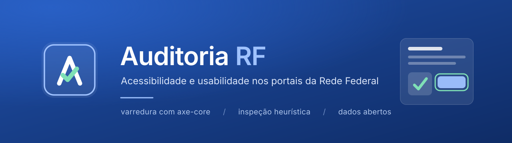

<p align="center">
  
</p>

<p align="center">
  Plataforma que audita os portais dos Institutos Federais em duas camadas: varredura automatizada com axe-core e inspeção manual guiada, gerando relatórios orientados à correção.
</p>

<p align="center">
  <a href="https://playwright.dev/"></a>
  <a href="https://nodejs.org/"></a>
  <a href="https://www.typescriptlang.org/"></a>
  <a href="https://www.w3.org/TR/WCAG22/"></a>
  <a href="https://github.com/dequelabs/axe-core"></a>
  <a href="./docs/PLANO_DE_IMPLEMENTACAO.md"></a>
</p>

---

## Abrindo sem linha de comando

Quem só quer usar o sistema abre `launcher/Auditoria RF.exe` (Windows). Ele verifica o Docker Desktop, inicia se estiver parado, monta a aplicação, sobe API e front, aplica os dados iniciais e abre o navegador em `http://localhost:8080` — com uma janela mostrando cada etapa, um botão para criar a conta do auditor e outro para parar tudo depois.

Na primeira execução ele cria o `.env` a partir do `.env.example` — o `.env` não vai para o repositório, e sem ele o Docker nem inicia. Tudo o que ele faz fica registrado em `%LOCALAPPDATA%AuditoriaRFlauncher.log`, e a janela tem um link para abrir esse arquivo.

Único pré-requisito: [Docker Desktop](https://www.docker.com/products/docker-desktop/). Para recompilar o launcher, `powershell -ExecutionPolicy Bypass -File launcheruild.ps1`; ele usa o compilador C# que já vem no Windows, sem instalar nada.

## Rodando em 3 comandos

Precisa de [Node 22 LTS](https://nodejs.org/) (há um `.nvmrc`) e do Chromium do Playwright.

```bash
npm install                          # o prepare instala o hook de commit
cp .env.example .env                 # preencha CRAWLER_CONTACT_EMAIL
npx playwright install chromium      # navegador usado pelo motor de auditoria

npm run db:migrate && npm run db:seed
npm run create-auditor -- --email voce@iftm.edu.br --name "Seu Nome"
npm run dev                          # API em :3333, front em :5173
```

Sem compilador C++ na máquina (Windows, em geral), o `better-sqlite3` não compila. Nesse caso, suba a API em contêiner:

```bash
cd docker && docker compose up -d    # front em :8080, API em :3333, data/ persistente
```

## O que o sistema faz

A pesquisa mede acessibilidade e usabilidade dos portais da Rede Federal com um método que não cabe numa ferramenta automática sozinha. O sistema cobre as duas metades:

**Camada automatizada.** Descobre as rotas de cada portal (robots.txt → sitemap e menu da página inicial → rastreamento até 2 níveis) e ordena as candidatas de cada função por relevância; o auditor confirma quais URLs correspondem a cada função de página, e então cada página é aberta no Chromium e verificada pelo axe-core contra as regras WCAG 2.2 AA. Passes, violations, incomplete e inapplicable são guardados — não só as violações — junto com o HTML renderizado, a versão do axe e a do navegador.

**Camada manual.** Cada achado automatizado é confirmado ou registrado como falso positivo, sempre com justificativa: a taxa de confirmação é um resultado da pesquisa, não um detalhe de implementação. Somam-se tarefas-alvo com o mesmo enunciado em todos os portais e a verificação com teclado, leitor de tela, ampliação a 200%, legendas e contraste.

**Publicação.** Os resultados ficam públicos, com exportação em CSV e dicionário de dados, e uma página que explica o que a nota mede — e o que ela não mede.

## Decisões que definem o projeto

| Decisão | Por quê |
| --- | --- |
| Conformidade = `passes / (passes + violations)` | mede regras aplicáveis, não uma contagem crua de erros |
| Portal que falhou é **ausência de dado** | tratar como 0% inventaria um número e distorceria a média |
| A métrica principal é **problemas distintos** | senão um portal com mais páginas pareceria pior só por ter mais páginas |
| Problema em ≥ 80% das páginas é **de template** | corrigir uma vez resolve o portal inteiro: é a recomendação de maior retorno |
| Falso positivo **nunca é apagado** | a taxa de confirmação mede o quanto a ferramenta serve sem revisão humana |
| Versões de axe-core e navegador **congeladas** | atualizar muda o conjunto de regras e invalida a comparação entre coletas |
| Uma coleta por vez por domínio, 1,5 s entre requisições | limite ético de carga sobre servidores públicos |

Cada uma está registrada como ADR curto em [`docs/decisoes/`](./docs/decisoes) — são 12 — e detalhada no [plano de implementação](./docs/PLANO_DE_IMPLEMENTACAO.md).

## Acessibilidade do próprio sistema

Uma ferramenta que mede acessibilidade não pode ser inacessível. O projeto se audita:

- os testes de componente rodam **axe em cada tela** (Vitest + Testing Library);
- `npm run dogfood` roda o **próprio motor de auditoria contra o front** e sai com erro se houver achado crítico;
- o ESLint roda `jsx-a11y` em modo estrito;
- nenhum texto abaixo de 13 px, cor nunca é a única informação, foco movido para o `<h1>` a cada rota, alvos de no mínimo 24×24 px e `prefers-reduced-motion` respeitado.

## Stack

| Camada | Escolha |
| --- | --- |
| Front | [React 19](https://react.dev/), [Vite 8](https://vite.dev/), [Tailwind CSS v4](https://tailwindcss.com/), TanStack Query, React Hook Form |
| API | [Express 5](https://expressjs.com/), [Drizzle ORM](https://orm.drizzle.team/) sobre SQLite (`better-sqlite3`), Zod, argon2 |
| Auditoria | [Playwright 1.63](https://playwright.dev/) + [axe-core 4.13](https://github.com/dequelabs/axe-core) |
| Compartilhado | `@auditoria-rf/contracts`: o mesmo schema Zod valida a entrada na API e tipa a resposta no front |
| Testes | Vitest, Supertest, Testing Library, `vitest-axe`, Playwright |

## Scripts

| Comando | O que faz |
| --- | --- |
| `npm run dev` | sobe API (`:3333`) e front (`:5173`) juntos |
| `npm run lint` | ESLint + `prettier --check` |
| `npm run typecheck` | `tsc --noEmit` em cada workspace |
| `npm test` | testes de unidade e integração |
| `npm run test:e2e` | fluxos principais no navegador (Playwright) |
| `npm run dogfood -- --base <url>` | audita o próprio front; sai com erro se houver achado crítico |
| `npm run discover -- --institution=<sigla>` (ou `--all`) | descobre as rotas nos portais reais e mostra as candidatas por função |
| `npm run collect -- --institution=<sigla>` | executa uma coleta pela linha de comando |
| `npm run create-auditor -- --email <e-mail> --name <nome>` | cria a conta do auditor (não há cadastro público) |
| `npm run db:migrate` / `npm run db:seed` | migrations e dados iniciais (funções, tarefas-alvo e as 42 instituições da Rede Federal) |

## Estrutura

```
apps/
  api/     Express + SQLite, em camadas por módulo de domínio
           routes → controllers → services → repositories → db
           infra/ crawler, auditor (Playwright + axe), fila, travas, eventos (SSE)
           cli/   descoberta, coleta, criação de auditor, dogfooding — sobre os mesmos services
  web/     React + Vite, organizado por feature, com design system em components/ui
packages/
  contracts/  schemas Zod e tipos compartilhados entre front e API
docker/       imagens da API (Node 22 + Chromium) e do front (nginx), com volume em data/
launcher/     launcher gráfico para Windows: sobe tudo com um duplo clique
docs/         plano de implementação e ADRs
```

## Implantação

A demonstração roda local com `docker compose up`, a partir de um banco já populado — não depende de internet nem de terceiros. Hospedagem serverless não serve: o Playwright precisa de um navegador instalado e de execuções longas, e o SQLite precisa de um arquivo em disco que sobreviva entre requisições.

## Quando a rede ou um portal bloqueia a ferramenta

| Situação | O que fazer |
| --- | --- |
| A máquina só sai para a internet por proxy (rede do campus) | defina `CRAWLER_PROXY=http://proxy:porta` no `.env`: crawler e navegador da coleta passam a usá-lo |
| Portal com certificado sem a intermediária | nada: a descoberta completa a cadeia pelo AIA, como o navegador |
| Portal lento ou fora do ar | a descoberta tenta de novo uma vez, respeita o `Retry-After` e para depois de 10 falhas seguidas, guardando o que achou |
| robots.txt com erro de servidor (5xx) | a descoberta não prossegue (RFC 9309); tente mais tarde |
| Portal responde 403 à ferramenta (firewall) | **não contornar** (trocar o user-agent feriria o método): registre como ausência de dado ou peça à TI da instituição que libere o user-agent `AuditoriaRF` |
| Ambiente de nuvem sem acesso aos portais (ex.: sessão remota com rede restrita) | libere os domínios `.edu.br`, `.g12.br`, `cefetmg.br` e `cefet-rj.br` nas configurações de rede do ambiente, ou rode na sua máquina |

Detalhes na ADR [0012](./docs/decisoes/0012-robustez-da-coleta.md).

## Limitações conhecidas

- A nota cobre **apenas critérios verificáveis automaticamente**; não atesta conformidade integral com a WCAG 2.2.
- Áreas autenticadas (AVA, SUAP) estão fora do escopo — só páginas públicas são avaliadas.
- Não há testes com participantes humanos; a inspeção assistiva é conduzida pelo pesquisador e não substitui o uso real por pessoas com deficiência.
- Modo escuro fora do escopo: dobraria a verificação de contraste sem ganho para a pesquisa.

## Créditos

Otávio Kessler Ustra — trabalho de pesquisa em Ciência da Computação, Instituto Federal do Triângulo Mineiro (IFTM). Design no [Figma](https://www.figma.com/design/KqdzslCA6CFhZKBCqP4zhf/TCC-%E2%80%94-Auditoria-de-acessibilidade-e-usabilidade).
